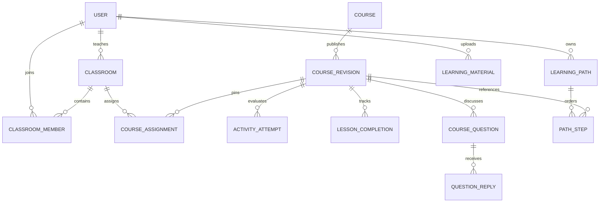

# 扩展数据模型设计

本目录是设计约定，不被 db:migrate 执行。管理员与班级领域已于 2026-10-27 实施，实际状态以相应迁移和领域说明为准；其余未启用条目仍是计划。实际开发某领域时，负责人基于本设计新增 `database/migrations/<timestamp>_<domain>.sql` 并验收，不修改任何已应用迁移。

## 现有表

认证表由 Better Auth 管理。业务现有 courses、course_revisions、enrollments、submissions、teacher_feedback，另有尚无完整业务实现的 learning_profiles、generation_jobs。

CourseDraft 继续用于原有文字/开放回答流程；新 AuthoringDraft 通过独立活动配置扩充，不把答题正确选项意外塞进公共课程列表。发布快照中的活动配置和课程内容须在同一事务冻结。

## 新增与扩展映射

| 领域                               | 计划表或变更                                         | 关键字段与约束                                                                                                                                                                 |
| ---------------------------------- | ---------------------------------------------------- | ------------------------------------------------------------------------------------------------------------------------------------------------------------------------------ |
| 班级（结构保留，功能待接入）       | classrooms                                           | id、teacher_id、name、description、created_at、status(active/archived)、archive_reason、archived_by、archived_at；teacher/管理员外键 user                                      |
| 班级成员（结构保留，功能待接入）   | classroom_members                                    | (class_id, student_id) 主键、joined_at；只允许学生；班级拥有者查询名单                                                                                                         |
| 班级邀请码（结构保留，功能待接入） | classroom_join_codes / classroom_join_attempts       | class_id 主键、token_hash UNIQUE、expires_at；更换即替换旧码，仅保存哈希；join_attempts 持久限制尝试次数                                                                       |
| 邮箱邀请                           | classroom_invitations                                | id、class_id、email_normalized、token_hash UNIQUE、expires_at、accepted_by、accepted_at；一次性消费                                                                            |
| 课程分配（结构保留，功能待接入）   | course_assignments                                   | id、class_id、course_id、course_version、due_at、assigned_at、revoked_at；唯一 class+course+version，复合外键指向 course_revisions                                             |
| 编辑并发                           | courses 扩展                                         | draft_revision 独立递增；已存在 version/published_version 的行为需与新服务共同升级                                                                                             |
| 活动配置                           | course_draft_activities / course_revision_activities | 草稿按 course+activity，快照按 course+version+activity；learner JSON 与私有 evaluation JSON 分列或显式投影；在发布事务内复制                                                   |
| 下架管理                           | courses 的 moderation 列（已实现）                   | moderation_status(active/withdrawn)、moderation_reason、moderated_by、moderated_at；使用同一课程行锁协调下架与学习写入，服务所有读取/写入均须检查                              |
| 章节完成                           | lesson_completions                                   | (student_id, course_id, course_version, lesson_id) 唯一、completed_at；复合外键版本，服务核对章节存在                                                                          |
| 新活动尝试                         | activity_attempts                                    | id、student_id、course_id、course_version、activity_id、response JSON、feedback、score、max_score、idempotency_key、request_hash、created_at；评分空值成对且 0≤score≤max_score |
| 角色扮演                           | roleplay_sessions / roleplay_messages                | 会话绑定学生、课程版本、活动；消息有服务端角色和 turn_index；消息顺序唯一，结束不可追加                                                                                        |
| 学习档案                           | learning_profiles 扩展                               | 复用 user_id；补 difficulty、available_minutes_per_week、结构化 goals；不直接把旧 JSON 学习路径视为新路径实现                                                                  |
| 学习路径                           | learning_paths / learning_path_steps                 | 路径 owner_id；步骤 path+order 唯一、path+course 唯一，引用已发布版本，target_minutes>0                                                                                        |
| 私有材料                           | learning_materials                                   | id、owner_id、object_key UNIQUE、filename、content_type、size_bytes、status、extracted_text、created_at；内容对象在独立存储                                                    |
| 提问                               | course_questions                                     | id、student_id、course_id、course_version、可选 lesson_id、message、status、created_at；教师拥有课程才可读                                                                     |
| 回复                               | course_question_replies                              | id、question_id、teacher_id、message、created_at；校验教师仍拥有课程                                                                                                           |
| 管理审计                           | admin_audit_events                                   | id、admin_id、action、target_id、必要且脱敏的变更摘要、created_at；不记录密码、令牌、连接串                                                                                    |
| 异步课程生成                       | generation_jobs 扩展                                 | 复用 owner_id/kind/status/input/result；添加 lease_token_hash、lease_expires_at、updated_at、安全失败说明；kind=course 的结果符合 AuthoringDraft                               |
| 操作幂等                           | operation_keys 或领域唯一约束                        | (actor_id, operation, key) 唯一，保留 request_hash 及结果引用；同 key 不同内容拒绝                                                                                             |

数据库不能只依赖 JSON 有字段就认定结构正确。服务解析 Zod schema，SQL 再检查外键、所有权、已发布状态、当前班级关系和并发前置条件。

## 核心关系

## 一致性与授权

- 用户身份只来自服务端会话。对资源的每次读写都必须带 actor 范围，不能先全量读取再在页面过滤。
- 现有 cohort 课程是公开教学目录；班级分配指定学习安排与版本，不把这个字段当成班级 ID。个人课程 visibility=personal，只有所有者可创作和学习，不能进入目录或分配到班级。
- 学习访问来源明确区分：公开教学课程的有效加入、当前有效的班级分配及成员关系、个人课程所有权。移除班级成员不能继续依赖旧的自动加入记录授权；另有合法直接加入的公开课程访问可独立保留。
- 下架覆盖目录、加入、材料读取、所有课程版本学习与提交，保留作者查看、审计与历史记录。增加下架接口时必须同步升级原有服务与 SQL，不能只更新一张状态表。
- 发布时锁定课程行，比较 expectedDraftRevision，创建单独快照和活动配置，再更新 published_version。同一草稿重复发布应幂等，不能生成重复版本。
- 分配、路径、完成记录和活动尝试引用确切发布版本。重新发布不会将旧进度算到新版本。
- 角色修改和会话撤销在同一事务，最后一个管理员保护需采用锁来防止并发降级。教师仍有班级/课程时，先返回冲突并要求明确所有权处理。
- 管理员默认查看教学课程元数据，不代表获得学生私有正文、私有材料和模型凭据的访问权。
- 测验答案只由可信服务读取用于判分；学生投影明确选择题面字段，不使用 SELECT * 或直接序列化作者 JSON。
- 新进度服务兼容旧 submissions 的开放回答历史，但只能选择一个来源作为同一条历史记录，禁止双重计数。迁移策略须在实际领域迁移中定义，不能静默丢弃旧记录。

## 启用顺序

1. 班级/成员/分配，以及课程草稿并发、个人所有权、统一学习授权。
2. 版本化活动配置、尝试、章节完成与问答。
3. 档案/路径、对象存储/解析、管理员管理；管理员下架上线前必须改造所有旧访问路径。
4. 异步 worker，只有真实执行器可用才启用任务接口。

每个领域以新增迁移、Neon adapter、服务权限测试、页面联调一起交付。不要为“先占位”向真实库应用无用或不完整的 SQL。

## 班级代码撤回后的数据库状态（2026-10-28）

班级重复实现已撤回，等待协作者分支接入。上述班级相关表结构是已执行迁移的历史，不代表当前存在可用班级页面或服务。迁移 002/003 及数据保持不变，不执行回滚或删除。

当前学习授权只使用 `enrollments.direct_access=true` 的独立选课；false 记录保留历史，不用于授权。管理员用户/课程功能保留。未来班级授权、单课程绑定与历史版本分配规则由班级负责人明确并通过兼容迁移接入，见 [班级交接说明](../../docs/engineering/classrooms.md)。
