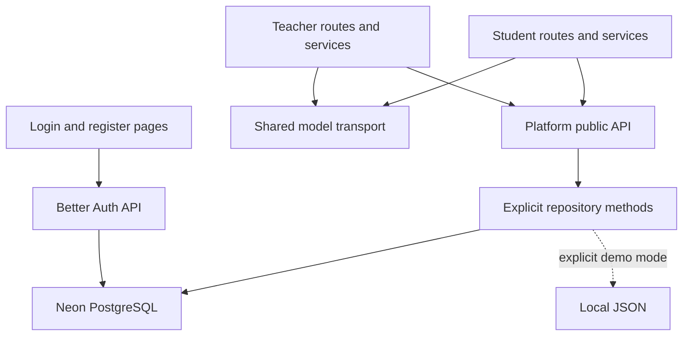

# Architecture

One Next.js / TypeScript application, split into teacher, student and platform modules. Neon PostgreSQL is the selected live database. Better Auth runs inside the application; this project does not use Neon's separate managed Auth product.

## Ownership

- Teacher: `src/modules/teacher/` and `src/app/(workspace)/teacher/`.
- Student: `src/modules/student/` and `src/app/(workspace)/student/`.
- Platform: auth, authorization, repository ports, data and management scripts. Shared services are exported by its `index.ts`.
- Shared: UI, types, generic AI transport and database adapters. It cannot depend on teacher/student modules.
- Root layout only imports global styles. Protected workspace layout checks a real session; auth pages are public.

## Shared UI

React and Tailwind CSS 4 use shadcn/ui primitives under `src/shared/ui/components/`. The root `components.json` configures the official CLI. Shared theme tokens live in `styles.css`; existing screen styles are imported from `legacy.css` in the components layer so Tailwind utilities can override them. Business screens compose these primitives inside their own modules. See [UI conventions](ui.md).

## Live data

The live adapter uses parameterized SQL against relational tables and reads only the current actor's workspace data. It does not load a global JSON state or overwrite the entire database.

Publishing writes a separate course revision inside a transaction. Student content reads the published revision; submissions store its version. Future editing must create a new revision without mutating old snapshots.

Password hashing, cookie signing, session expiry/revocation and authentication request checks belong to Better Auth. User role is a server-owned additional field, never editable by public registration/update requests. Teacher promotion is a CLI operation with database access and revokes previous sessions.

## Modes and limits

Default mode is `neon`. Missing configuration displays an unavailable login form; it does not silently switch to demo. `demo` must be explicitly selected and remains single-process local only.

Email verification and password reset email are not configured. Real cloud connectivity is verified only after supplying DATABASE_URL and running migrations. Embedded PostgreSQL tests validate SQL/auth behavior but do not prove a specific Neon project's networking or permissions.

Neon stores course data and media references. File upload needs a separate object storage adapter. Long media-generation jobs need a worker; online code execution needs a dedicated sandbox.

## Complete-scope extension contracts (2026-10-17)

The screenshot scope now has explicit domain schemas and service entry points, rather than relying on future folders or loose JSON fields. `platformExtensions` groups domain services; each domain owns a separate implementation file. Implemented operations validate the session actor, role and input, then call an actor-scoped Neon repository that re-checks ownership in SQL. Reserved operations still use the reserved factory: they validate role and input and always fail with NOT_IMPLEMENTED, without resource authorization or external IO. Those checks remain mandatory before a domain is enabled.

As of 2026-10-20 the classroom roster is implemented: `create`, `get`, `deleteClass`, `listMine`, `listMembers`, `listStudents`, `importStudents` and `removeMember`. Invitations, join codes, course assignments and the other domains remain reserved. Membership is teacher-managed; students only see classes they were added to. As of 2026-10-20 a class also binds to one of its teacher's published cohort courses (`classrooms.course_id`); creating a class or importing students auto-enrolls the selected students in that course, while removing class membership leaves the enrollment intact. Class completion percentages are labeled static sample data, not tracked progress.

Course-generation prompts, validation and the existing generation implementation have moved to `src/modules/course-generation/`. Teacher compatibility re-exports remain. Student personal-course and advanced-generation operations are still reserved; shared location does not by itself grant student authoring permission.

New actor-scoped storage ports are separate from the current live PlatformRepository. Data-model changes are designed in `database/design/`; the classroom tables were the first design item to ship as real migrations, and each migration must be applied explicitly. See [feature contracts](feature-contracts.md) for requirements, result types, policies and activation gates.
