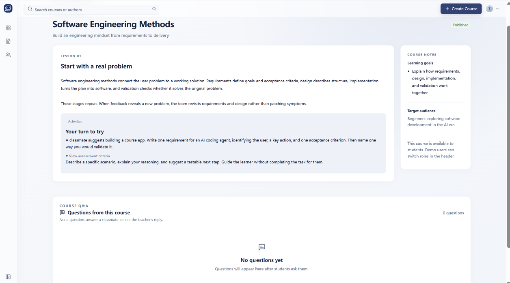
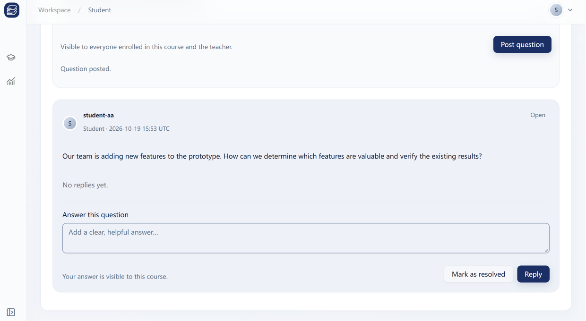
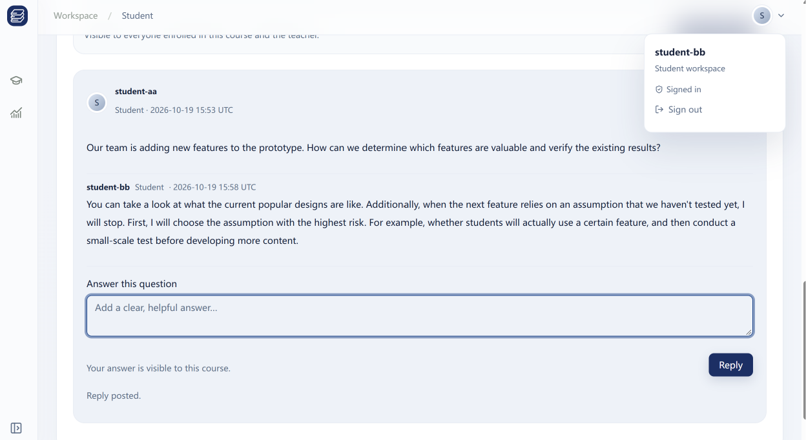
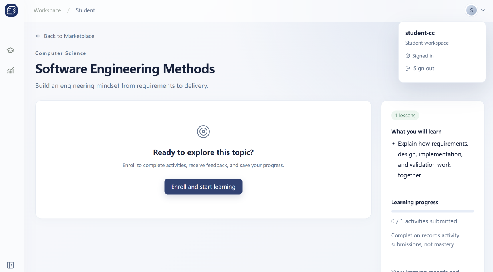
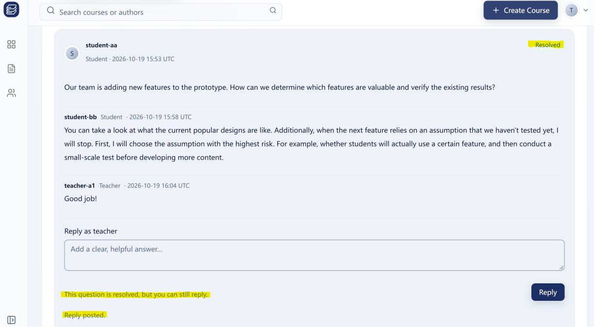
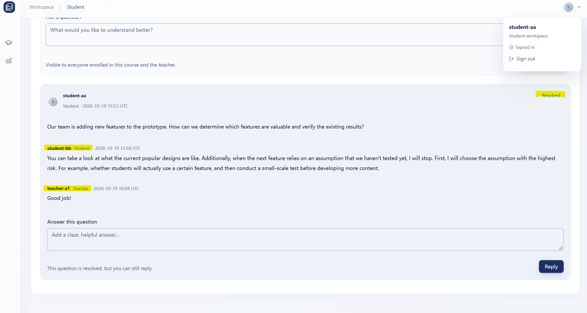
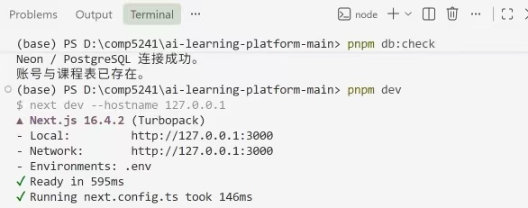

# 学生进度与教师互动管理：师生提问与反馈（Course Q&A）

- 记录日期：2026-10-20
- 代码分支：`feat/discussions`
- 本地环境：Next.js + Neon 分支数据库 `discussions-dev`
- 验收范围：课程内公开问答（提问、学生互相回答、教师回复、标记解决、非课程成员不可见）
- 相关文档：[讨论区实现](../../engineering/discussions.md)、[完整功能接口](../../engineering/feature-contracts.md)

## 1. 功能描述

学生/教师课程详情页接入 **Course Q&A**：

- 学生在已加入的课程内提问；
- 同一课程的学生可以看到彼此的问题并互相回答；
- 授课教师可以查看自己课程的全部问答、回复，并标记解决；
- 仅提问者本人和授课教师可以标记解决；
- 未加入课程的学生看不到该课程的问答区。

教师查看学生活动提交并提供个别反馈仍使用既有 **Teaching Management** 页面，本记录聚焦讨论区本身。

## 2. 权限说明

| 角色       | 权限                                                                    |
| ---------- | ----------------------------------------------------------------------- |
| 学生       | 必须加入课程后，方可查看/回答该课程全部问题；可以标记解决自己提出的问题 |
| 教师       | 仅针对自己授课的课程，可查看/回答/标记解决                              |
| 非课程成员 | 不可见                                                                  |

作者身份全部来自服务端会话；表单不接收 `studentId`、`teacherId`、`role` 等身份字段。

## 3. 数据表

新增两张表：

- `discussion_questions`：课程、发布版本、可选章节、提问学生、内容、状态、时间；
- `discussion_replies`：问题、作者、作者角色、内容、时间。

迁移文件：

```text
database/migrations/202610190001_discussions.sql
```

## 4. 数据库与共用接口

可能影响其他模块或需要基建负责人审核的改动：

- 新增迁移 `database/migrations/202610190001_discussions.sql`；
- 修改 `src/shared/contracts/features/common.ts` 的 `FeatureDefinition.status`；
- 修改 `src/shared/contracts/features/discussions.ts` 的 `reply` 角色和作者字段；
- 修改 `src/shared/database/seed.ts` 和 `scripts/db/seed.ts`。

本地测试使用 Neon 分支 `discussions-dev`，该分支已应用 `202610190001_discussions.sql`。**主库尚未迁移**，部署前须在主库执行：

```bash
pnpm db:migrate
```

使用 **Direct connection**，创建 `discussion_questions` 和 `discussion_replies` 两张表。迁移只新增表，幂等，不修改已有表。

分支上的测试数据不会同步到主库；主库需要单独准备演示账号和已发布课程。如果正式库的 `DATABASE_URL` 有轮换，还需要同步更新 Vercel 的环境变量。

## 5. 测试账号

以下账号均创建在 Neon 分支 `discussions-dev`，主库尚无这些测试账号。密码不写入仓库。

| 显示名 / 标识 | 邮箱                     | 说明                       |
| ------------- | ------------------------ | -------------------------- |
| `teacher-a1`  | `teacher-a1@example.com` | 已提升为教师账号           |
| `student-aa`  | `student-aa@example.com` | 学生 A，加入软件工程课程   |
| `student-bb`  | `student-bb@example.com` | 学生 B，加入软件工程课程   |
| `student-cc`  | `student-cc@example.com` | 学生 C，不加入软件工程课程 |

## 6. 基本功能验收

教师账号添加了 3 门已发布的示例课程，课程标题与 Figma 原型目录一致。以下为对应功能截图。

### 6.1 教师进入软件工程课程

教师 `teacher-a1` 进入 **My Creations**，打开 **Software Engineering Methods**，页面底部出现 `Student Questions` 面板。



### 6.2 学生 A 提问

学生 `student-aa` 加入课程后，在 `Course Q&A` 中提问。



### 6.3 学生 B 看到问题并回答

学生 `student-bb` 加入同一课程后，可以看到学生 A 的问题，并在下面回答。



### 6.4 非课程成员不可见

学生 `student-cc` 未加入软件工程课程，打开同一课程详情页时看不到 `Course Q&A` 区域。



### 6.5 教师回复并标记解决

教师 `teacher-a1` 在 `Student Questions` 中查看学生 A、B 的问答，回复并将问题标记为 `Resolved`。



### 6.6 学生 A 查看教师反馈

学生 `student-aa` 刷新课程页面，可以看到学生 B 和教师的回复，以及 `Resolved` 状态。



### 6.7 数据库连接与开发服务器

`pnpm db:check` 显示 Neon / PostgreSQL 连接成功，`pnpm dev` 正常启动开发服务器。讨论区两张表已通过只读查询确认存在于 `discussions-dev` 分支。



## 7. 自动化检查

```text
pnpm check
→ lint / typecheck / 57 tests / build 全部通过
```

新增的 pglite 集成测试覆盖：

- 非课程成员不可见；
- 其他教师不可见；
- 学生之间可以互相回答；
- 作者信息正确；
- 提问者/教师可以标记解决，其他学生不能；
- 旧课程版本、未知章节被拒绝；
- 分页与教师按学生过滤。

## 8. 后续计划改进

- 添加撤回/删除已发布评论功能；
- 添加表情表态功能。
- 添加通知、未读状态功能。

建议后续采用软删除（记录 `deleted_at` / `deleted_by`），并新增独立的 `discussion_reactions` 表；每项功能单独迁移、单独 PR。

## 9. 限制与说明

- 主库尚未执行本次迁移；部署前须由基建/部署负责人对主库执行 `pnpm db:migrate`。
